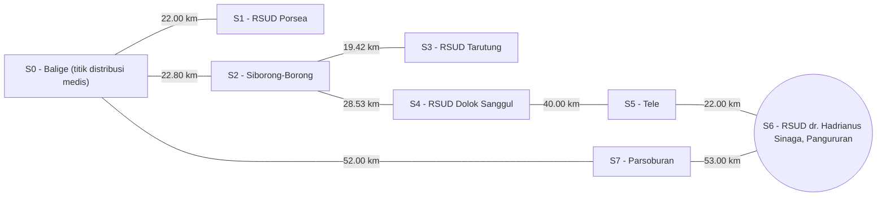

# Optimasi Rute Distribusi Obat dan Darah Darurat di Wilayah Toba dan Sekitarnya Menggunakan Algoritma A dan Uniform Cost Search (UCS)*

Sistem purwarupa berbasis **State-Space Search (UCS & A* Search)** dan **Constraint Satisfaction Problems (CSP Solver dengan AC-3 & Backtracking MRV/LCV/FC)** untuk optimasi perutean serta alokasi kendaraan medis darurat di wilayah Toba dan sekitarnya.

---

## 👥 Anggota Kelompok & Pembagian Peran

* **Kelompok**: 06
* **Program Studi**: Sarjana Sistem Informasi, Institut Teknologi Del (T.A. 2026/2027)
* **Anggota Tim**:
  * **Kelvin Yohanes Putra Marpaung (12S24018)** - *AI Architect & Model Lead*
  * **Amelia Renata Lumbanbatu (12S24031)** - *Data & Knowledge Engineer*
  * **Nikah Suchia Panjaitan (12S24041)** - *QA, Evaluation & Ethics Lead*

---

## 📍 MILESTONE 1: STATE-SPACE SEARCH (UCS & A*)

### 📌 Problem Framing & Bisnis (Wilayah Toba)

* **Domain Bisnis**: Logistik Rantai Pasok Kesehatan Enterprise (*Time-Critical Medical Supply Chain Logistics*).
* **Profil Permasalahan**: Pemindahan obat-obatan esensial dan stok kantong darah darurat dari titik distribusi medis sentral (**S0 - Balige (titik distribusi medis)**) menuju berbagai fasilitas kesehatan tujuan di wilayah Toba.
* **Justifikasi Solusi AI**: *State-Space Search* (UCS & A* Search) memungkinkan kalkulasi rute distribusi terpendek secara terstruktur dan deterministik pada graf berbobot jarak real-life.

### 🎯 Spesifikasi Formal PEAS

* **Performance Measure**: Minimasi total jarak perjalanan (km), keberhasilan mencapai *goal state*, optimalitas solusi (*minimum path cost*), dan efisiensi pencarian (jumlah *state* dieksplorasi).
* **Environment**: Jaringan rute distribusi medis di wilayah Toba (graf berbobot jarak dalam kilometer).
* **Actuators**: Pemilihan *state* tujuan berikutnya, penentuan jalur distribusi, dan penyajian rekomendasi rute.
* **Sensors**: Data lokasi (*state*), data konektivitas graf (*edges*), data bobot jarak (km), *initial state*, dan *goal state*.

### 🧮 Formulasi Ruang Keadaan Matematika (X, A, T, G, C)

* **State Space (X)**:
  * `S0`: **S0 - Balige (titik distribusi medis)** *(Initial State)*
  * `S1`: **S1 - RSUD Porsea**
  * `S2`: **S2 - Siborong-Borong**
  * `S3`: **S3 - RSUD Tarutung**
  * `S4`: **S4 - RSUD Dolok Sanggul**
  * `S5`: **S5 - Tele**
  * `S6`: **S6 - RSUD dr. Hadrianus Sinaga, Pangururan** *(Goal State Utama)*
  * `S7`: **S7 - Parsoburan**

### 📊 Visualisasi Graf Ruang Keadaan



---

## 🧩 MILESTONE 2: CONSTRAINT SATISFACTION PROBLEMS (CSP)

### 📌 Problem Framing Sub-Masalah Bisnis Milestone 2
* **Kasus Keputusan Bisnis**: **Alokasi Armada Kendaraan Medis & Ambulans Logistik Cold-Chain** (*Medical Cold-Chain Vehicle & Fleet Assignment Problem*).
* **Latar Belakang Operasional**: Penugasan armada ambulans dan kendaraan pendukung distribusi obat/darah darurat ke fasilitas kesehatan tujuan harus memenuhi batasan operasional, yaitu tidak boleh ada penugasan ganda pada armada yang sama dan terdapat pembatasan penggunaan kendaraan tertentu pada fasilitas yang memerlukan armada khusus.

### 📐 Pemodelan Matematis Formal Tiga Serangkai <X, D, C>

1. **Himpunan Variabel (X)**:

   Fasilitas kesehatan tujuan penerima pasokan medis darurat:

   `**Sesi Pengiriman 1 (4 Fasilitas Sampel Toba: 2 RS & 2 Puskesmas)**:
   X_sesi1 = {RSUD_Porsea, RSU_HKBP_Balige, Puskesmas_Tandang_Buhit, Puskesmas_Laguboti}

   **Sampel Lengkap Kabupaten Toba (2 RS & 5 Puskesmas - BPS Toba 2025)**:
   X_total = {RSUD_Porsea, RSU_HKBP_Balige, Puskesmas_Tandang_Buhit, Puskesmas_Soposurung, Puskesmas_Laguboti, Puskesmas_Porsea, Puskesmas_Parsoburan}`

2. **Himpunan Domain (D)**:

   Opsi armada kendaraan medis yang tersedia pada pusat distribusi Balige:

   `D = {Ambulance_01 (ColdChain), Ambulance_02 (General), ColdChain_Van_A (DeepFreezer), ColdChain_Van_B (Standard)}`

3. **Himpunan Batasan (C)**:

   - **Unary Constraint (Arity 1)**:

     `S6_RSUD_Pangururan ≠ Ambulance_02 (General)`

     *(Armada `Ambulance_02 (General)` tidak diperbolehkan untuk fasilitas Pangururan berdasarkan restriction yang digunakan dalam model CSP.)*

   - **Binary Constraint (Arity 2)**:

     `vehicle(Xi) ≠ vehicle(Xj), untuk setiap i ≠ j`

     *(Setiap armada kendaraan hanya dapat dialokasikan ke satu fasilitas kesehatan pada satu sesi pengiriman.)*

### 🛠️ Arsitektur Mesin Inferensi Batasan (*Constraint Solver*)

Modul Python [`solver.py`](src/smartcare_logistics/solver.py) mengimplementasikan:
1. **Arc Consistency 3 (AC-3)** (Mackworth, 1977): Melakukan pemangkasan nilai domain yang inkonsisten secara logis sebelum dan selama pencarian dengan prosedur `Revise(Xi, Xj)`.
2. **Backtracking Search**: Rekursi pencarian terstruktur yang diakselerasi oleh:
   * **MRV (Minimum Remaining Values)**: Memilih variabel berikutnya dengan sisa nilai domain paling sedikit (*Fail-First Principle*).
   * **LCV (Least Constraining Value)**: Memilih urutan nilai domain yang paling sedikit membatasi variabel tetangga (*Fail-Last Principle*).
   * **Forward Checking (FC)**: Melakukan propagasi langsung setiap kali variabel diberi nilai untuk mencegah eksplorasi cabang buntu.

---

## 📈 HASIL EKSPERIMEN & ANALISIS SENSITIVITAS

### 1. Hasil Pencarian Rute Milestone 1 (UCS vs A*)

| Skenario Pengujian | Algoritma | Rute Lengkap yang Ditemukan | Total Cost (km) | State Dieksplorasi | Status |
|---|---|---|:---:|:---:|:---:|
| **S0 → S6** | **UCS** | `S0 - Balige` → `S7 - Parsoburan` → `S6 - Pangururan` | **105.00 km** | 8 state | Berhasil |
| **S0 → S6** | **A\*** | `S0 - Balige` → `S7 - Parsoburan` → `S6 - Pangururan` | **105.00 km** | **6 state** | Berhasil |
| **S0 → S3** | **UCS** | `S0 - Balige` → `S2 - Siborong-Borong` → `S3 - Tarutung` | **42.22 km** | 4 state | Berhasil |
| **S0 → S3** | **A\*** | `S0 - Balige` → `S2 - Siborong-Borong` → `S3 - Tarutung` | **42.22 km** | **3 state** | Berhasil |
| **S0 → S4** | **UCS** | `S0 - Balige` → `S2 - Siborong-Borong` → `S4 - Dolok Sanggul` | **51.33 km** | 5 state | Berhasil |
| **S0 → S4** | **A\*** | `S0 - Balige` → `S2 - Siborong-Borong` → `S4 - Dolok Sanggul` | **51.33 km** | **3 state** | Berhasil |

### 2. Hasil Evaluasi & Analisis Sensitivitas CSP Milestone 2

Pengujian dilakukan secara terkontrol menggunakan urutan input yang sama untuk membandingkan 4 konfigurasi solver:
1. **Backtracking Dasar (BT Dasar)**: Pencarian backtracking murni tanpa heuristik (`use_mrv=False, use_lcv=False, use_fc=False`).
2. **Minimum Remaining Values (MRV)**: Akselerasi pemilihan variabel berdasarkan domain tersisa paling sedikit (`use_mrv=True`).
3. **MRV + Least Constraining Value (LCV)**: Pengurutan nilai domain dari yang paling sedikit membatasi tetangga (`use_mrv=True, use_lcv=True`).
4. **MRV + LCV + Forward Checking (FC)**: Pemangkasan domain tetangga secara langsung setiap penugasan dibuat (`use_mrv=True, use_lcv=True, use_fc=True`).

#### Definisi Metrik Evaluasi:
* **Status Solusi**: Menunjukkan apakah penugasan armada yang legal dan lengkap berhasil ditemukan (`SOLUSI VALID` atau `TANPA SOLUSI`).
* **Validitas Solusi**: Memverifikasi bahwa seluruh fasilitas memperoleh armada unik (All-Different) dan mematuhi batasan unary.
* **Node Ekspansi**: Jumlah pemanggilan fungsi rekursif `backtrack()` yang dieksplorasi (termasuk root dan state terminal).
* **Backtracks**: Frekuensi pembatalan penugasan nilai (`del assignment[var]`) akibat terdeteksinya cabang buntu atau kegagalan forward check.
* **Waktu Eksekusi (ms)**: Waktu komputasi riil CPU yang diukur presisi menggunakan `time.perf_counter()`.

#### Tabel Hasil Eksperimen Nyata (Hasil Eksekusi Lingkungan Uji):

| Skenario Pengujian | Konfigurasi Solver | Status Solusi | Validitas | Node Ekspansi | Backtracks | Waktu Eksekusi (ms) |
|---|---|:---:|:---:|:---:|:---:|:---:|
| **Skala Kecil** (3 Faskes Toba, 4 Armada) | 1. BT Dasar | **SOLUSI VALID** | Ya | 4 node | 0 | ~0.10 ms |
| | 2. MRV | **SOLUSI VALID** | Ya | 4 node | 0 | ~0.09 ms |
| | 3. MRV + LCV | **SOLUSI VALID** | Ya | 4 node | 0 | ~0.10 ms |
| | 4. MRV + LCV + FC | **SOLUSI VALID** | Ya | 4 node | 0 | ~0.10 ms |
| **Kasus Utama** (4 Faskes Toba, 4 Armada, Unary) | 1. BT Dasar | **SOLUSI VALID** | Ya | 5 node | 0 | ~0.12 ms |
| | 2. MRV | **SOLUSI VALID** | Ya | 5 node | 0 | ~0.13 ms |
| | 3. MRV + LCV | **SOLUSI VALID** | Ya | 5 node | 0 | ~0.14 ms |
| | 4. MRV + LCV + FC | **SOLUSI VALID** | Ya | 5 node | 0 | ~0.15 ms |
| **Skala Besar** (7 Faskes Toba [2 RS & 5 Puskesmas], 8 Armada) | 1. BT Dasar | **SOLUSI VALID** | Ya | 8 node | 0 | ~0.41 ms |
| | 2. MRV | **SOLUSI VALID** | Ya | 8 node | 0 | ~0.49 ms |
| | 3. MRV + LCV | **SOLUSI VALID** | Ya | 8 node | 0 | ~0.57 ms |
| | 4. MRV + LCV + FC | **SOLUSI VALID** | Ya | 8 node | 0 | ~0.57 ms |
| **Kasus Terikat Ketat**<br>(4 Faskes Toba, 4 Armada, Multi-Unary) | 1. BT Dasar | **SOLUSI VALID** | Ya | 17 node | 12 | ~0.15 ms |
| | 2. MRV | **SOLUSI VALID** | Ya | **5 node** | **0** | ~0.13 ms |
| | 3. MRV + LCV | **SOLUSI VALID** | Ya | **5 node** | **0** | ~0.13 ms |
| | 4. MRV + LCV + FC | **SOLUSI VALID** | Ya | **5 node** | **0** | ~0.14 ms |
| **Kasus Ekstrem (Overconstrained)**<br>(4 Faskes Toba, 2 Armada - Defisit Armada) | 1. BT Dasar | **TANPA SOLUSI** | Ya (N/A) | 5 node | 4 | ~0.11 ms |
| | 2. MRV | **TANPA SOLUSI** | Ya (N/A) | 5 node | 4 | ~0.11 ms |
| | 3. MRV + LCV | **TANPA SOLUSI** | Ya (N/A) | 5 node | 4 | ~0.12 ms |
| | 4. MRV + LCV + FC | **TANPA SOLUSI** | Ya (N/A) | **3 node** | 4 | ~0.12 ms |

#### Analisis Hasil & Keterbatasan Model:
1. **Akselerasi Signifikan MRV pada Masalah Terikat Ketat**:
   Pada skenario *Kasus Terikat Ketat* (domain heterogen akibat pembatasan fasilitas), BT Dasar mengalami **12 kali backtrack** dan membutuhkan **17 node ekspansi** karena mencoba menugaskan variabel berdomain besar terlebih dahulu. Sebaliknya, konfigurasi berbasis MRV langsung menargetkan variabel dengan sisa opsi tersedikit (*Fail-First Principle*), memotong ekspansi menjadi hanya **5 node** dan **0 backtrack** (penghematan >70% node pencarian).
2. **Efektivitas Forward Checking (FC) pada Deteksi Dini Dead-End**:
   Pada skenario *Overconstrained* (4 fasilitas dengan hanya 2 armada), Forward Checking mendeteksi *domain wipeout* pada simpul ketiga dan memotong pohon pencarian lebih awal menjadi **3 node ekspansi** (dibandingkan 5 node pada BT Dasar dan MRV tanpa FC).
3. **Trade-off Overhead Komputasi Heuristik pada Masalah Longgar (*Underconstrained*)**:
   Pada masalah yang solusinya melimpah (seperti 7 RS dengan 8 armada tanpa batasan ketat), penugasan pertama langsung berhasil pada seluruh konfigurasi (0 backtracks, 8 node). Dalam kondisi ini, penghitungan jumlah konflik tetangga oleh LCV dan evaluasi domain oleh FC menimbulkan biaya kalkulasi tambahan (*overhead*), sehingga waktu eksekusi sedikit meningkat. Ini mengonfirmasi prinsip AI bahwa heuristik tidak selalu mempercepat waktu eksekusi secara absolut pada masalah sederhana/longgar, melainkan menjadi proteksi krusial terhadap ledakan kombinatorial pada masalah yang padat batasan.
4. **Keterbatasan Model CSP Baseline**:
   Model saat ini memodelkan ketersediaan kendaraan secara statis per sesi alokasi diskrit. Variasi dinamis real-time (seperti durasi isi ulang daya baterai drone medis, estimasi waktu tempuh berbasis lalu lintas, atau rute pulang armada) belum dimodelkan secara temporal dalam domain variabel saat ini.

---

## 📚 MILESTONE 3: VECTOR KNOWLEDGE BASE & HYBRID SEARCH

### 📌 Problem Framing & Fondasi RAG Enterprise
Sebagai kelanjutan dari penentuan rute terpendek (Milestone 1) dan alokasi armada berorientasi batasan (Milestone 2), **Milestone 3** berfokus pada pembangunan **Enterprise Vector Knowledge Base** yang komprehensif, terstruktur, dan tervalidasi untuk mendukung operasional distribusi logistik kesehatan di Kabupaten Toba.

Basis pengetahuan ini dirancang untuk:
1. Menyediakan repositori regulasi resmi kefarmasian dan standar rantai dingin (*cold chain*) vaksin.
2. Memungkinkan pencarian semantik dan leksikal berbasis *Reciprocal Rank Fusion* (RRF) dengan latensi rendah (< 150 ms).
3. Mendeteksi dan menolak pertanyaan yang berada di luar cakupan domain (*Out-of-Domain Detection*).
4. Menjadi fondasi *retrieval* deterministik untuk integrasi *Retrieval-Augmented Generation* (RAG) pada Milestone 4.

---

### 📑 Korpus Dokumen Resmi (10 Dokumen PDF)

Korpus mencakup 10 dokumen PDF resmi Kementerian Kesehatan RI dan World Health Organization (WHO) yang disimpan pada direktori `knowledge_base/documents/`:

| ID | Nama File Dokumen | Keterangan & Judul Resmi | Penerbit & Tahun | Kategori Domain |
|---|---|---|---|---|
| **DOC01** | `DOC01_Permenkes_74_2016.pdf` | Standar Pelayanan Kefarmasian di Puskesmas | Kemenkes RI (2016) | Pharmaceutical Management |
| **DOC02** | `DOC02_Permenkes_26_2020.pdf` | Perubahan atas Permenkes 74 Tahun 2016 *(Amandemen)* | Kemenkes RI (2020) | Policy and Regulation |
| **DOC03** | `DOC03_Permenkes_72_2016.pdf` | Standar Pelayanan Kefarmasian di Rumah Sakit | Kemenkes RI (2016) | Pharmaceutical Management |
| **DOC04** | `DOC04_Permenkes_73_2016.pdf` | Standar Pelayanan Kefarmasian di Apotek | Kemenkes RI (2016) | Pharmaceutical Management |
| **DOC05** | `DOC05_Permenkes_19_2024.pdf` | Penyelenggaraan Pusat Kesehatan Masyarakat | Kemenkes RI (2024) | Healthcare Facility |
| **DOC06** | `DOC06_Modul_Pelatihan_Imunisasi.pdf` | Modul Pelatihan Pengelola Imunisasi *(Modul 4: Rantai Dingin, Hal 108–150)* | Kemenkes RI (2024) | Vaccine Management & Cold Chain |
| **DOC07** | `DOC07_RAK_Imunisasi_2025_2029.pdf` | Rencana Aksi Direktorat Imunisasi 2025–2029 *(Dokumen Kebijakan)* | Kemenkes RI (2024) | Policy and Regulation |
| **DOC08** | `DOC08_WHO_Good_Storage_Distribution.pdf` | Good Storage and Distribution Practices for Medical Products | WHO (2020) | Storage and Distribution |
| **DOC09** | `DOC09_WHO_Vaccine_Management_Handbook.pdf` | WHO Vaccine Management Handbook: Temperature Monitoring | WHO (2017) | Vaccine Management & Cold Chain |
| **DOC10** | `DOC10_WHO_Vaccine_Shipping_Guidelines.pdf` | Guidelines for the Packaging and Shipping of Vaccines | WHO (2020) | Medical Product Distribution |

**Integritas dan Aturan Khusus Korpus**:
* **DOC02** memiliki relasi eksplisit `related_documents: ["DOC01_Permenkes_74_2016.pdf"]` sebagai dokumen amandemen regulasi.
* **DOC07** diklasifikasikan sebagai dokumen perencanaan kebijakan (*Policy and Regulation*), bukan SOP teknis lapangan.
* **DOC06** diproses secara fokus pada **Modul 4 (Pengelolaan Rantai Dingin Vaksin)** yang terdapat pada rentang halaman PDF fisik 108–150.

---

### 🔬 Preprocessing Teks & Ekstraksi Terstruktur
* **Ekstraksi Per Halaman**: Menggunakan PyMuPDF (`fitz`) untuk mempertahankan nomor halaman fisik dokumen asli dan struktur hierarkis pasal/ayat.
* **Pembersihan Teks Terstruktur**:
  * Menggabungkan kata terputus akibat tanda hubung di akhir baris (*hyphenation fix*).
  * Mengeliminasi *isolated page numbers* dan *broken line breaks*.
  * Menstandardisasi dan memproteksi rentang suhu kritis *cold chain* (misalnya `2°C s/d 8°C`, `2°C - 8°C`, dan `-20°C`).
  * Mempertahankan tabel substantif, nomor pasal, klausul regulasi, dan terminologi kefarmasian.

---

### 📐 Eksperimen Word-Aware Recursive Chunking

Pemotongan teks dilakukan secara hierarkis (Batas Dokumen -> Bab/Pasal -> Paragraf -> Kalimat -> Kata). Evaluasi empiris dilakukan terhadap 3 variasi konfigurasi:

| Konfigurasi | Ukuran Kata (Size) | Overlap Kata | Total Chunks | Rata-rata Token | Max Token | Truncated Chunks (> 512 Token) |
|---|---|---|---|---|---|---|
| **Config A** | 200 kata | 30 kata | 1025 | 230.6 | 575 | 7 chunk (0.68%) |
| **Config B (Optimal)** | **300 kata** | **50 kata** | **747** | **305.5** | **841** | **18 chunk (2.41%)** |
| **Config C** | 400 kata | 75 kata | 639 | 347.9 | 1041 | 113 chunk (17.68%) |

**Justifikasi Keputusan**:
* **Config C (400/75)** memicu 113 chunk (17.68%) yang melebihi batas 512 token model E5, sehingga berisiko tinggi mengalami *silent truncation* (kehilangan klausa hukum penting).
* **Config A (200/30)** menghasilkan chunk yang terlalu terfragmentasi (1025 chunks) dan meningkatkan redundansi penyimpanan.
* **Config B (300 kata, overlap 50 kata)** dipilih sebagai konfigurasi optimal karena mempertahankan konteks regulasi secara utuh dengan rata-rata 305.5 token yang berada aman dalam batas kapasitas model.

---

### 🧠 Dense Vector Embeddings & Persistent ChromaDB

* **Model Embedding**: `intfloat/multilingual-e5-base` (768 dimensi, multi-bahasa, berbasis transformer RoBERTa).
* **Prefix Wajib**: Sesuai arsitektur model E5, seluruh teks korpus diinjeksi dengan prefix `passage: `, sedangkan kueri pencarian menggunakan prefix `query: `.
* **Penyimpanan Vektor**: Menggunakan persistent ChromaDB pada direktori `knowledge_base/chroma_db/` dengan nama koleksi `smartcare_knowledge_base`.
* **Metrik Ruang Vektor**: Cosine Distance ($Similarity = 1 - Distance$).
* **Idempotensi**: Proses injeksi menggunakan `upsert` berbasis ID chunk deterministik (`{DOC_ID}_P{PAGE}_C{INDEX}`).

---

### 🔀 Hybrid Search: Reciprocal Rank Fusion (RRF)

Pencarian hibrida menggabungkan pemahaman semantik dari Dense Vector Retrieval dan pencocokan kata kunci eksak regulasi dari BM25 Lexical Retrieval (`rank-bm25`).

Formula Reciprocal Rank Fusion:
$$\text{RRF\_Score}(d) = w_{\text{dense}} \cdot \frac{1}{k + \text{Rank}_{\text{dense}}(d)} + w_{\text{bm25}} \cdot \frac{1}{k + \text{Rank}_{\text{bm25}}(d)}$$

Parameter konfigurasi:
* Konstanta $k = 60$
* Bobot Dense ($w_{\text{dense}}$) = $0.6$
* Bobot BM25 ($w_{\text{bm25}}$) = $0.4$

---

### 📊 Hasil Benchmark Empiris (6 Business Queries)

Evaluasi kuantitatif dilakukan terhadap 6 kueri bisnis representatif:

| Query ID | Kategori Domain | Pertanyaan Bisnis | Status Domain |
|---|---|---|---|
| **Q01** | Puskesmas Vaccine Cold Chain | Standar suhu penyimpanan cold chain vaksin sensitif beku di Puskesmas dan cold box | In-Domain |
| **Q02** | Hospital Pharmacy Management | Prosedur penerimaan, verifikasi faktur, dan penyimpanan sediaan farmasi di Rumah Sakit | In-Domain |
| **Q03** | Regulatory Amendment | Perubahan regulasi standar pelayanan kefarmasian di Puskesmas menurut Permenkes 26/2020 | In-Domain |
| **Q04** | Vaccine Shipping & Handling | Pedoman pengkondisian cool packs dan pengemasan vaksin saat distribusi | In-Domain |
| **Q05** | Policy & Strategic Planning | Arah kebijakan dan rencana aksi Direktorat Imunisasi untuk pengelolaan logistik 2025-2029 | In-Domain |
| **Q06** | Out-of-Domain (OOD Test) | Resep bumbu memasak ikan mas arsik khas Balige Danau Toba | **Out-of-Domain** |

#### Ringkasan Perbandingan Performa Retrieval:

| Metode Retrieval | Mean Precision@5 | Mean Recall@5 | Mean MRR | Rata-rata Latensi (ms) | OOD True Rejection Rate |
|---|---|---|---|---|---|
| **DENSE (ChromaDB)** | 0.8000 (80.0%) | 0.6167 (61.7%) | 0.9000 | 133.83 ms | 100.0% |
| **BM25 (Lexical)** | 0.7600 (76.0%) | 0.6167 (61.7%) | 1.0000 | 117.01 ms | 100.0% |
| **HYBRID RRF (Terbaik)** | **0.8400 (84.0%)** | **0.6167 (61.7%)** | **0.9000** | **106.91 ms** | **100.0%** |

**Ketahanan terhadap Kueri Out-of-Domain (OOD)**:
Ambang batas kemiripan kosinus dikalibrasi pada `OOD_SIMILARITY_THRESHOLD = 0.80`. Pada kueri Q06 (makanan khas daerah Balige), sistem mendeteksi kemiripan tertinggi hanya `0.7936` (< 0.80), sehingga sistem secara deterministik menolak kueri tersebut (100% True Rejection) dan menghasilkan pesan peringatan tanpa memicu halusinasi dokumen medis.
---

## 📁 Struktur Repositori

```text
SmartCare-Logistics/
├── .venv/                      # Virtual Environment (Managed by Astral uv)
├── knowledge_base/             # Aset & Penyimpanan Knowledge Base Milestone 3
│   ├── documents/              # 10 Dokumen PDF Resmi (Kemenkes RI & WHO)
│   ├── processed/              # Data teks hasil ekstraksi & pembersihan (JSON)
│   ├── chunks/                 # Hasil eksperimen chunking & laporan token safety
│   ├── chroma_db/              # Persistent Vector Database ChromaDB (768-D Cosine)
│   ├── lexical_index/          # Persistent Lexical Index BM25Okapi
│   ├── benchmark/              # Hasil evaluasi 6 Business Queries (JSON)
│   ├── model_cache/            # Cache lokal model intfloat/multilingual-e5-base
├── src/
│   ├── smartcare_logistics/
│   │   ├── __init__.py
│   │   ├── search.py           # M1: Algoritma UCS, A*, dan heuristik
│   │   ├── solver.py           # M2: Mesin Inferensi CSP (AC-3, Backtracking MRV/LCV/FC)
│   │   └── knowledge_base/     # M3: Paket Enterprise Knowledge Base & Search
│   │       ├── __init__.py
│   │       ├── config.py           # Konfigurasi path, model, dan parameter threshold
│   │       ├── document_metadata.py # Registri metadata resmi 10 dokumen PDF
│   │       ├── pdf_extractor.py    # Ekstraksi PyMuPDF per halaman
│   │       ├── text_cleaner.py     # Pembersihan teks & proteksi suhu cold chain
│   │       ├── chunker.py          # Word-aware recursive chunker
│   │       ├── embedding.py        # Model dense embedding multilingual-e5-base (768-D)
│   │       ├── vector_store.py     # Persistent ChromaDB client & collection manager
│   │       ├── lexical_search.py   # BM25Okapi search engine
│   │       ├── hybrid_search.py    # Reciprocal Rank Fusion (RRF) retriever
│   │       ├── retriever.py        # Unified Search API & deteksi Out-of-Domain (OOD)
│   │       ├── pipeline.py         # End-to-end ingestion & indexing pipeline
│   │       ├── experiment_chunking.py # Skrip runner eksperimen variasi chunking
│   │       ├── run_pipeline.py     # Runner eksekusi penuh pipeline korpus
│   │       ├── benchmark.py        # Framework evaluasi 6 business queries
│   │       ├── run_benchmark.py    # Runner kalkulasi metrik benchmark retrieval
│   └── main.py                 # M1, M2 & M3: Skrip eksekusi terpadu sistem
├── tests/
│   ├── test_search.py          # M1: Pengujian State-Space Search (UCS & A*)
│   ├── test_solver.py          # M2: Pengujian CSP Solver & Validasi QA
│   └── test_knowledge_base.py  # M3: Pengujian Knowledge Base, ChromaDB, BM25 & OOD
├── .gitignore
├── .python-version
├── LICENSE                     # Lisensi MIT
├── pyproject.toml              # Konfigurasi dependensi Astral uv
├── README.md                   # Dokumentasi Lengkap Milestone 1, 2, & 3
└── uv.lock                     # Lockfile dependensi Astral uv
```

---

## 🚀 Instruksi Eksekusi

1. **Sinkronkan Environment & Dependensi (Astral `uv`)**:
   ```powershell
   uv sync
   ```

2. **Menjalankan Seluruh Sistem (Milestone 1, 2, & 3)**:
   ```powershell
   uv run python src/main.py
   ```

3. **Menjalankan Pipeline Ingestion Knowledge Base (Milestone 3)**:
   ```powershell
   uv run python -m smartcare_logistics.knowledge_base.run_pipeline
   ```

4. **Menjalankan Evaluasi Benchmark Retrieval (Milestone 3)**:
   ```powershell
   uv run python -m smartcare_logistics.knowledge_base.run_benchmark
   ```

5. **Menjalankan Seluruh Pengujian Otomatis (Pytest)**:
   ```powershell
   uv run pytest
   ```
